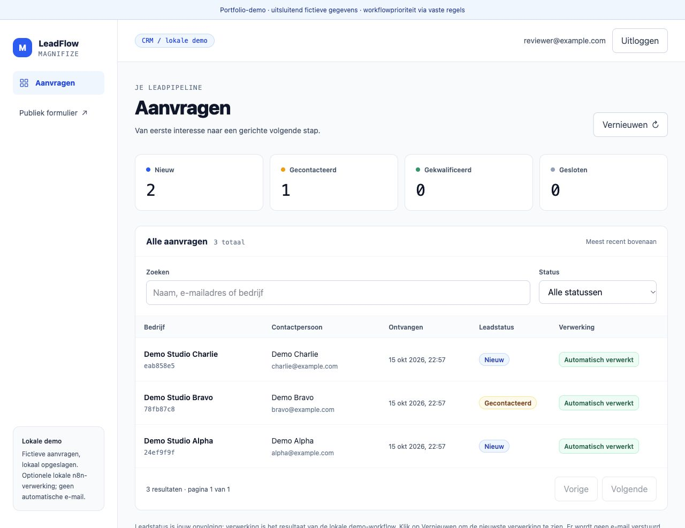
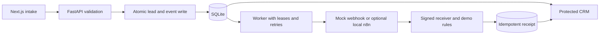

# LeadFlow

**A local lead intake and follow-up app with a durable, retryable automation workflow.**

A portfolio project by Karim, a first-year AI student at Vrije Universiteit Amsterdam. Built together with an AI coding assistant (see [How I worked on this](#how-i-worked-on-this)); cleaned from my existing Magnifize LeadFlow project.



## The problem

A form submission is only the start of a process. It needs reliable storage, an obvious place for follow-up, and a workflow that can recover when delivery fails without processing the same event twice.

## What it does

- Validates intake requests and stores leads in local SQLite.
- Uses idempotency keys to avoid duplicate submissions.
- Writes a lead and its workflow event in one transaction.
- Delivers events with leases, retries and a stored processing receipt.
- Shows workflow processing separately from the CRM status a person chooses.
- Provides a local admin login, search, filters, detail view, version-aware updates and status history.

The receiver assigns a small demo priority using **fixed rules, not AI**. It does not send email. All included seed records are explicitly synthetic.

## Run locally

Requires Python 3.11+ and Node.js 20.9+. The project contains dependency lockfiles. Creating an environment and installing dependencies is an explicit setup step.

Backend setup, if dependencies are not already installed:

```bash
cd backend
python3 -m venv .venv
.venv/bin/python -m pip install -r requirements-lock.txt
```

Start the backend from `backend/`:

```bash
.venv/bin/python -m app.seed
.venv/bin/python -m uvicorn app.main:app --host 127.0.0.1 --port 8000
```

In another terminal, install frontend dependencies if needed, then start it:

```bash
cd frontend
npm ci
npm run dev
```

Open <http://127.0.0.1:3000> (the interface is in Dutch). Use fictitious data in the form. At `/dashboard`, create your own local demo login. Its hash is stored in an ignored `.env`; no preset login is included.

Safe local defaults work without copying `.env.example`. Optional settings are documented there and in `frontend/.env.local.example`. Keep backend keys out of `NEXT_PUBLIC_` variables. Admin access is intentionally loopback-only.

### Try the automation without n8n

From `backend/`, with dependencies available:

```bash
.venv/bin/python -m app.demo
```

This creates a temporary mock lead, repeats its submission, runs the actual worker against an **in-process mock HTTP webhook**, and verifies a single processing receipt. The output labels the mock transport. It does not start n8n or call an external service.

Check the app's actual queue separately with `.venv/bin/python -m app.automation_cli status`. Automatic delivery stays off by default, so newly submitted events can remain pending until a transport is explicitly configured.

### Optional n8n definition

`outputs/leadflow-n8n-workflow.json` contains an inactive workflow definition with a placeholder credential reference and no pinned execution data. A project-local n8n helper and locked package definition are included. Live n8n setup imports a credential and publishes a local workflow; it must be a deliberate, separate action. It was **not run** during this preparation.

The Supabase repository adapter is retained as experimental source. Its production setup and migrations are outside this showcase's verified path.

## Architecture



The offline demo mocks the HTTP transport; unit tests also cover the signed receiver. A receipt and a delivered event are separate facts. Manual lead status stays under the user's control.

## Tech stack

Python, FastAPI, Pydantic, SQLite, httpx, Next.js, React, TypeScript and Tailwind CSS. Optional local n8n adapter.

## Verification

From `backend/`:

```bash
.venv/bin/python -m pytest -q
```

From `frontend/`:

```bash
npm run typecheck
npm run build
```

Verified during preparation: **104 backend tests passed; 1 live n8n test was skipped**. TypeScript checking, the Next.js production build, seed command and offline automation demo passed. Browser checks covered login, lead details, workflow status, status saving and responsive views.

Tests ran on Python 3.14.7 / Node.js 24.19.0, including from a fresh copy with a new virtual environment (`pip install -r requirements-lock.txt`) and `npm ci`: 104 backend tests passed (1 skipped), and the TypeScript check and production build passed. The existing Playwright suite was retained but not run in this preparation. One upstream FastAPI/Starlette test-client deprecation warning remains. No dependency upgrade was performed.

Screenshots use a separate mock QA database. Workflow receipts shown there were produced with a mock HTTP transport; they are not evidence of a live n8n run or client usage.

## How I worked on this

I built this together with an AI coding assistant. I decided what the app should do, then read, ran and tested what we produced. These are the design choices I can explain:

- **A lead and its workflow event are written in one transaction**, so a saved lead can never lose its follow-up.
- **Idempotency keys make duplicate submissions harmless**, because the same request can arrive twice.
- **Delivery uses leases and retries.** A worker that crashes mid-delivery doesn't lose the event or process it twice.
- **A processing receipt and the CRM status are separate facts.** Automation shows what happened; a person still decides the lead's status.
- **Priority uses fixed rules, not AI**, so its behaviour can be tested and explained.

## Lessons learned

- Commit an event alongside the lead to avoid losing follow-up work.
- Treat retries and duplicate delivery as normal conditions.
- Show evidence of processing independently from a person's CRM decision.
- Keep private configuration, generated state and captures separate from source.

## What I would improve next

Run the fresh-install check automatically in CI, a documented n8n integration run, production authentication and a tested production storage/outbox migration. Evaluate whether a small CRM needs a workflow tool or a simpler worker for its first deployment.

No production deployment, real clients, AI classification, conversion gains or other business results are claimed.

## License

[MIT](LICENSE). Third-party dependencies retain their own licenses.
